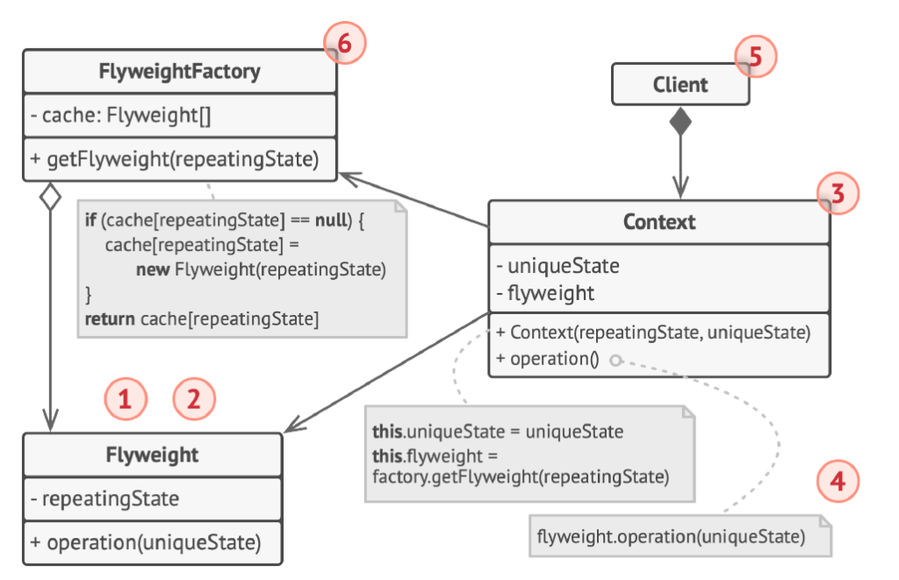

# Flyweight (Peso Ligero)

## ¿Qué es Flyweight?

Flyweight es un patrón de diseño **estructural** cuyo propósito principal es **reducir el consumo de memoria RAM permitiendo compartir objetos**, centralizando el estado común entre múltiples entidades lógicas en lugar de duplicar los datos en cada instancia.

En lugar de crear objetos completamente independientes y pesados para cada elemento del sistema, este patrón extrae los datos repetidos y los agrupa en instancias compartidas denominadas *flyweights*. Esto permite gestionar volúmenes masivos de entidades de manera eficiente, manteniendo un bajo consumo de memoria.

El patrón establece una distinción fundamental entre dos categorías de estado:

1. **Estado intrínseco:** Información constante, invariante e independiente del contexto. Es compartible entre múltiples objetos y se almacena internamente dentro del propio objeto *flyweight*.
2. **Estado extrínseco:** Información variable que depende del contexto específico de uso y es única para cada aparición de la entidad. Se almacena o calcula en el cliente/contexto y se pasa al *flyweight* como argumento en el momento de invocar sus operaciones.

---

## Estructura general


**Descripción de los componentes de la arquitectura:**

1. **La interfaz Flyweight (el contrato abstracto):** Declara los métodos a través de los cuales los objetos *flyweight* reciben y procesan el estado extrínseco. Define el contrato uniforme que permite al cliente interactuar con las instancias compartidas sin depender de su estado interno.
2. **Los Flyweights Concretos (*Concrete Flyweights*):** Implementan la interfaz `Flyweight` y almacenan de forma exclusiva el **estado intrínseco**. Deben ser estrictamente inmutables respecto al contexto, de modo que una misma instancia pueda ser utilizada simultáneamente y sin efectos colaterales por múltiples clientes.
3. **Los Flyweights Concretos No Compartidos (*Unshared Concrete Flyweights*, opcional):** Representan elementos de la jerarquía que implementan la interfaz `Flyweight` pero que, por diseño o requerimiento del dominio, no se comparten y mantienen tanto su estado intrínseco como extrínseco.
4. **La Fábrica de Flyweights (*Flyweight Factory*):** Componente responsable de crear, indexar y administrar el ciclo de vida de los objetos *flyweight*. Mantiene un catálogo o caché interna (típicamente una tabla asociativa o mapa). Cuando se solicita una instancia, la fábrica verifica si ya existe una coincidente para retornarla; en caso contrario, la crea, la registra y la devuelve al solicitante.
5. **El Contexto y el Cliente:** El contexto encapsula el **estado extrínseco** y conserva una referencia al *flyweight* correspondiente. El cliente orquesta el sistema solicitando las instancias compartidas a la fábrica y desencadenando las operaciones necesarias, proveyendo en cada invocación el estado extrínseco correspondiente.

---

## El problema

Considérese el motor de renderizado de un simulador forestal o videojuego que debe representar un **bosque denso** compuesto por un millón de árboles individuales. Cada árbol requiere almacenar su posición espacial en el terreno (`x`, `y`), así como sus características visuales y taxonómicas (nombre de especie, color y la textura gráfica de alta resolución correspondiente).

Al abordar la representación de un volumen masivo de objetos mediante el enfoque convencional de la programación orientada a objetos, surgen dos problemas arquitectónicos críticos:

**Problema 1: Duplicación masiva de memoria por estado redundante.**
Si cada entidad árbol encapsula independientemente todos sus datos gráficos y descriptivos, la memoria requerida escala linealmente con el número de árboles:

```java
// Ejemplo del diseño ingenuo a evitar:
public class ArbolNaive {
    private int x;
    private int y;
    private String nombre;    // "Pino", "Roble", etc.
    private String color;     // "Verde oscuro", "Verde claro", etc.
    private String textura;   // Imagen o mapa de bits de alto peso en RAM
}
```

En un bosque de **1.000.000 de árboles** donde solo coexisten **2 o 3 especies**, los datos de textura, color y nombre se replican exactamente un millón de veces. Multiplicar estructuras pesadas de texturas por cientos de miles de instancias agota rápidamente la memoria RAM disponible del sistema, provocando desbordamientos de memoria (*OutOfMemoryError*) o degradaciones severas en el rendimiento del recolector de basura.

**Problema 2: Acoplamiento entre la identidad del objeto y sus coordenadas espaciales.**
Al mezclar las propiedades visuales invariantes de una especie con las coordenadas posicionales únicas de cada árbol en una única clase monolítica, se imposibilita la reutilización de instancias idénticas en memoria, obligando a recrear todo el objeto únicamente porque sus coordenadas espaciales (`x`, `y`) difieren.

---

## La solución

El patrón Flyweight propone **extraer el estado compartido invariante fuera de la entidad contextual**, segregando los datos en dos estructuras bien delimitadas:

- **La clase `TipoArbol` (Flyweight Concreto):** Encapsula exclusivamente los atributos intrínsecos e inmutables de la especie arbórea (`nombre`, `color`, `textura`). No almacena información de coordenadas espaciales. En su lugar, recibe las coordenadas (`x`, `y`) como parámetros en su método `dibujar(int x, int y)`.
- **La clase `Arbol` (Contexto):** Modela la entidad individual en el terreno de forma ligera. Almacena únicamente el estado extrínseco (`x`, `y`) y una referencia al objeto compartido `TipoArbol`.
- **La clase `FabricaTipoArbol` (Flyweight Factory):** Administra un registro centralizado (`Map<String, TipoArbol>`). Antes de instanciar un nuevo tipo de árbol, consulta si ya existe una instancia creada para la clave compuesta (`nombre-color-textura`). Si existe, la reutiliza; si no, la crea y la almacena.
- **La clase `Bosque` (Cliente):** Gestiona la colección de árboles del terreno, delegando la obtención de tipos a la fábrica y orquestando el renderizado global.

Como resultado:

- Aunque existan 1.000 árboles plantados en el bosque, en memoria únicamente se alojan **2 instancias** de `TipoArbol`.
- Cada objeto `Arbol` individual queda reducido a un contenedor liviano de coordenadas posicionales y un puntero de referencia en memoria.

El sistema logra una reducción sustancial del consumo de RAM, preservando la capacidad de representar una cantidad masiva de elementos en pantalla.

---

## Estructura de la solución



---

## Código para probar

### Flyweight Concreto: TipoArbol.java

```java
// TipoArbol.java
public class TipoArbol {
    private final String nombre;
    private final String color;
    private final String textura;

    public TipoArbol(String nombre, String color, String textura) {
        this.nombre = nombre;
        this.color = color;
        this.textura = textura;
    }

    // x e y son el estado extrínseco: lo recibe el flyweight, no lo guarda
    public void dibujar(int x, int y) {
        System.out.println("Dibujando " + nombre + " (" + color + ", " + textura
                + ") en (" + x + ", " + y + ")");
    }
}
```

### Contexto: Arbol.java

```java
// Arbol.java
public class Arbol {
    private final int x;
    private final int y;
    private final TipoArbol tipo; // referencia compartida

    public Arbol(int x, int y, TipoArbol tipo) {
        this.x = x;
        this.y = y;
        this.tipo = tipo;
    }

    public void dibujar() {
        tipo.dibujar(x, y);
    }
}
```

### Fábrica de Flyweights: FabricaTipoArbol.java

```java
// FabricaTipoArbol.java
import java.util.HashMap;
import java.util.Map;

public class FabricaTipoArbol {
    private static final Map<String, TipoArbol> tipos = new HashMap<>();

    public static TipoArbol obtenerTipo(String nombre, String color, String textura) {
        String clave = nombre + "-" + color + "-" + textura;
        TipoArbol tipo = tipos.get(clave);

        if (tipo == null) {
            tipo = new TipoArbol(nombre, color, textura);
            tipos.put(clave, tipo);
            System.out.println("Creando nuevo tipo: " + clave);
        }
        return tipo;
    }

    public static int cantidadTipos() {
        return tipos.size();
    }
}
```

### Clase Cliente: Bosque.java

```java
// Bosque.java
import java.util.ArrayList;
import java.util.List;

public class Bosque {
    private final List<Arbol> arboles = new ArrayList<>();

    public void plantarArbol(int x, int y, String nombre, String color, String textura) {
        TipoArbol tipo = FabricaTipoArbol.obtenerTipo(nombre, color, textura);
        arboles.add(new Arbol(x, y, tipo));
    }

    public void dibujar() {
        for (Arbol arbol : arboles) {
            arbol.dibujar();
        }
    }
}
```

### Programa Principal: Main.java

```java
// Main.java
public class Main {
    public static void main(String[] args) {
        Bosque bosque = new Bosque();

        // 1000 árboles, pero solo 2 tipos distintos
        for (int i = 0; i < 500; i++) {
            bosque.plantarArbol(i, i * 2, "Pino", "Verde oscuro", "textura_pino.png");
            bosque.plantarArbol(i * 3, i, "Roble", "Verde claro", "textura_roble.png");
        }

        bosque.dibujar();

        System.out.println("Árboles plantados: 1000");
        System.out.println("Objetos TipoArbol creados: " + FabricaTipoArbol.cantidadTipos());
    }
}
```

Salida esperada:

```
Creando nuevo tipo: Pino-Verde oscuro-textura_pino.png
Creando nuevo tipo: Roble-Verde claro-textura_roble.png
Dibujando Pino (Verde oscuro, textura_pino.png) en (0, 0)
Dibujando Roble (Verde claro, textura_roble.png) en (0, 0)
Dibujando Pino (Verde oscuro, textura_pino.png) en (1, 2)
Dibujando Roble (Verde claro, textura_roble.png) en (3, 1)
Dibujando Pino (Verde oscuro, textura_pino.png) en (2, 4)
Dibujando Roble (Verde claro, textura_roble.png) en (6, 2)
...
Dibujando Pino (Verde oscuro, textura_pino.png) en (499, 998)
Dibujando Roble (Verde claro, textura_roble.png) en (1497, 499)
Árboles plantados: 1000
Objetos TipoArbol creados: 2
```

Como se evidencia en la ejecución, a pesar de haberse plantado e invocado el renderizado de 1.000 instancias de árboles, la fábrica únicamente crea en memoria 2 instancias físicas de `TipoArbol`. Las 998 invocaciones restantes reutilizan las referencias compartidas, suministrando en cada ciclo las coordenadas contextuales correspondientes.

---

## Cuándo usarlo y cuándo no

**Aplicabilidad (Cuándo usarlo):**

- Cuando la aplicación necesita generar un volumen extremadamente elevado de objetos similares y la memoria RAM disponible es un recurso crítico.
- Cuando la mayor parte del estado de los objetos puede externalizarse y segregarse en un componente intrínseco (invariante) y un componente extrínseco (contextual).
- Cuando múltiples grupos de objetos lógicos pueden representarse mediante un conjunto reducido de objetos compartidos una vez extraído el estado dependiente del contexto.
- Cuando el estado intrínseco es inmutable y no depende de la identidad particular de cada cliente que lo utiliza.

**Contraindicaciones (Cuándo evitarlo):**

- Cuando la aplicación no experimenta restricciones reales de memoria, ya que la separación de estados y la introducción de fábricas añaden una complejidad estructural innecesaria.
- Cuando el cálculo o la transferencia del estado extrínseco introduce una sobrecarga de CPU que anula los beneficios del ahorro de memoria obtenido.
- Cuando casi la totalidad de los datos del objeto corresponden a atributos individuales e intrínsecamente variables, impidiendo un nivel de compartición representativo.

---

## Resumen

| Dimensión | Patrón Flyweight |
|---|---|
| **Clasificación** | Estructural |
| **Problema que resuelve** | Consumo excesivo de memoria RAM por la instanciación masiva de objetos que poseen atributos idénticos y repetidos; duplicación innecesaria de datos invariantes. |
| **Implementación en Java** | Segregación del estado en intrínseco (`TipoArbol`) y extrínseco (`Arbol`); empleo de una fábrica con catálogo o caché (`FabricaTipoArbol`) para garantizar una única instancia por tipo y paso de coordenadas en el método de ejecución. |
| **Ventajas** | Reducción drástica del consumo de memoria RAM; reutilización segura de instancias compartidas inmutables; alta escalabilidad ante volúmenes masivos de entidades. |
| **Desventajas** | Incremento de la complejidad del código al dividir los objetos en dos capas (intrínseca/extrínseca); potencial penalización en tiempos de procesamiento (CPU) si el cálculo del estado contextual es complejo. |
| **Patrones relacionados** | **Singleton**: La fábrica de flyweights suele implementarse como instancia única global para centralizar la caché; **Composite**: A menudo los nodos hoja de una estructura jerárquica compuesta se implementan como flyweights compartidos; **Factory Method**: Utilizado por la fábrica para encapsular la instanciación de las variantes de flyweights. |
